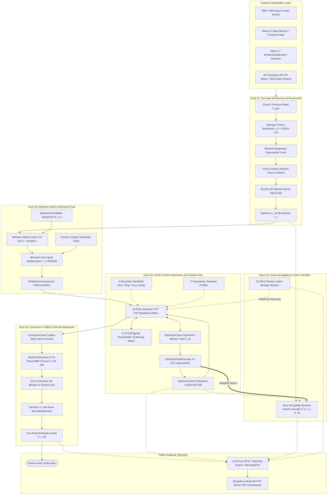
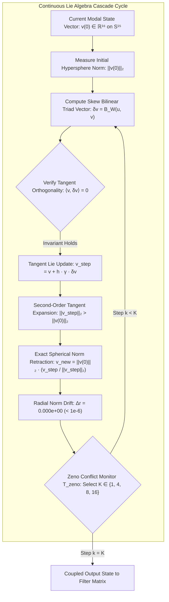

# PF-02 · System Architecture & Mathematical Foundations

[](#continuous-lie-algebraic-primitives-project-darksnail)
[](#mathematical-invariants--proof-derivations)
[-orange.svg)](#polyphony-threading--real-time-telemetry)

---

## Table of Contents

1. [Executive Physical & Mathematical Summary](#executive-physical--mathematical-summary)
2. [Continuous Lie-Algebraic Primitives (Project DarkSnail)](#continuous-lie-algebraic-primitives-project-darksnail)
   - [so(16) Lie Algebra & Skew-Symmetric Matrix Generators](#so16-lie-algebra--skew-symmetric-matrix-generators)
   - [Skew-Symmetric Bilinear Triad Operator](#skew-symmetric-bilinear-triad-operator)
   - [SlowFastTriadCascade & Spherical Norm Retraction](#slowfasttriadcascade--spherical-norm-retraction)
   - [Beltrami Triad-Flux Outlier Shielding](#beltrami-triad-flux-outlier-shielding)
   - [Zeno-Amygdala Adaptive Dynamic Unroll Controller](#zeno-amygdala-adaptive-dynamic-unroll-controller)
   - [201-Channel Jordan Cavity Field](#201-channel-jordan-cavity-field)
   - [Wasserstein-1 & Fisher-Rao Geometric Metrics](#wasserstein-1--fisher-rao-geometric-metrics)
3. [Aeroacoustics & Contact Mechanics (MR-16 Physical Modeling)](#aeroacoustics--contact-mechanics-mr-16-physical-modeling)
   - [Karnopp Stick-Slip Friction & Velocity Deadband](#karnopp-stick-slip-friction--velocity-deadband)
   - [Stribeck Breakaway Exponential Velocity](#stribeck-breakaway-exponential-velocity)
   - [Hunt-Crossley Hertzian Viscoelastic Contact Impact](#hunt-crossley-hertzian-viscoelastic-contact-impact)
   - [Buchla 292 Optical Vactrol Sag Droop](#buchla-292-optical-vactrol-sag-droop)
   - [Minnaert Gas-Liquid Bubble Bank](#minnaert-gas-liquid-bubble-bank)
   - [Poisson Stochastic Droplet Point-Process Clock](#poisson-stochastic-droplet-point-process-clock)
   - [Bjorklund Euclidean Peristaltic Sequencer](#bjorklund-euclidean-peristaltic-sequencer)
4. [Modal Resonator Matrix & Scattering](#modal-resonator-matrix--scattering)
   - [16-Pole Zavalishin TPT SVF Bandpass Matrix](#16-pole-zavalishin-tpt-svf-bandpass-matrix)
   - [O(N) Orthogonal Householder Energy Scattering Matrix](#on-orthogonal-householder-energy-scattering-matrix)
   - [Four Geometric Acoustic Manifolds](#four-geometric-acoustic-manifolds)
   - [Five Viscoelastic Material Damping Profiles](#five-viscoelastic-material-damping-profiles)
5. [Non-Linear Dynamics, Spatial Modulation & Mastering](#non-linear-dynamics-spatial-modulation--mastering)
   - [3D Runge-Kutta 4th-Order Chaotic Lorenz Attractor](#3d-runge-kutta-4th-order-chaotic-lorenz-attractor)
   - [Roland Dimension D Tri-Phase BBD Chorus (Mono Immunity Proof)](#roland-dimension-d-tri-phase-bbd-chorus-mono-immunity-proof)
   - [Constant-Power Golden-Ratio Stereo Modal Panning](#constant-power-golden-ratio-stereo-modal-panning)
   - [Infrasonic 15 Hz DC Blocker & Visceral Sub-Bass](#infrasonic-15-hz-dc-blocker--visceral-sub-bass)
   - [Hermite C¹ Soft-Knee BoundedSaturator & Peak Limiter](#hermite-c¹-soft-knee-boundedsaturator--peak-limiter)
6. [Polyphony, Threading & Real-Time Telemetry](#polyphony-threading--real-time-telemetry)
   - [VoiceManager & Allocation Policies](#voicemanager--allocation-policies)
   - [Lock-Free SPSC Telemetry Queue & Web Audio MessagePort](#lock-free-spsc-telemetry-queue--web-audio-messageport)
   - [Zero-Allocation Audio Thread Enforcement](#zero-allocation-audio-thread-enforcement)
7. [Vector CRT Visualizer Engine](#vector-crt-visualizer-engine)
8. [Comprehensive Architecture & Signal-Flow Mermaid Diagrams](#comprehensive-architecture--signal-flow-mermaid-diagrams)

---

## Executive Physical & Mathematical Summary

Poopenfarten II (`PF-02`) solves a coupled non-linear ordinary differential equation (ODE) system at each audio sample interval $\Delta t = 1/f_s$. The physical domain consists of:
1. An upstream colonic fluid reservoir driven by muscular pressure head $P_{\text{gut}}(t)$.
2. An elastic mucosal aperture slit $y(t)$ governed by viscoelastic tissue mechanics, stick-slip friction, and Hertzian restitution impact.
3. An aeroacoustic swirling jet obeying the helical Beltrami condition $\nabla \times \mathbf{v} = \lambda \mathbf{v}$.
4. A 16-dimensional modal acoustic resonator whose state vector $\mathbf{v}(t) \in \mathbb{R}^{16}$ evolves under a continuous $\mathfrak{so}(16)$ Lie-algebraic triad generator, constrained exactly to the $S^{15}$ unit hypersphere via spherical norm retraction.
5. An audio-rate Zeno-Amygdala monitor dynamically selecting the numerical unroll depth $K \in \{1, 4, 8, 16\}$ based on instantaneous phase divergence.

---

## Continuous Lie-Algebraic Primitives (Project DarkSnail)

### so(16) Lie Algebra & Skew-Symmetric Matrix Generators

The Lie algebra $\mathfrak{so}(16)$ consists of all real $16 \times 16$ skew-symmetric matrices:

```math
\mathfrak{so}(16) = \left\lbrace \mathbf{A} \in \mathbb{R}^{16 \times 16} \;\middle|\; \mathbf{A}^\top = -\mathbf{A} \right\rbrace
```

For any arbitrary real matrix $\mathbf{B} \in \mathbb{R}^{16 \times 16}$, its projection onto $\mathfrak{so}(16)$ is computed via the skew-symmetrization map:

```math
\mathbf{A} = \frac{1}{2}\left(\mathbf{B} - \mathbf{B}^\top\right)
```

By construction, all diagonal elements vanish identically ($A_{ii} = 0$), and off-diagonal elements satisfy $A_{ij} = -A_{ji}$. Consequently, the quadratic form of any skew-symmetric operator on a state vector $\mathbf{v} \in \mathbb{R}^{16}$ satisfies exact energy preservation:

```math
\mathbf{v}^\top \mathbf{A} \mathbf{v} = \sum_{i=1}^{16}\sum_{j=1}^{16} v_i A_{ij} v_j = \frac{1}{2}\sum_{i=1}^{16}\sum_{j=1}^{16} v_i (A_{ij} + A_{ji}) v_j = 0
```

The infinitesimal generator $\mathbf{A}$ generates pure isometric rotations on the sphere $S^{15}$.

### Skew-Symmetric Bilinear Triad Operator

To model multi-mode non-linear acoustic energy transfer without energy runaway, Project DarkSnail introduces the 3-tensor bilinear triad operator $S(\mathbf{W}, i, c_1, c_2)$. Given weight tensor $\mathbf{W} \in \mathbb{R}^{16 \times 16 \times 16}$, the operator is defined by:

```math
S(\mathbf{W}, i, c_1, c_2) = \frac{1}{2}\left(W_{i, c_1, c_2} - W_{i, c_2, c_1}\right)
```

Given two state vectors $\mathbf{u}, \mathbf{v} \in \mathbb{R}^{16}$, the bilinear vector field $B_{\mathbf{W}}(\mathbf{u}, \mathbf{v}) \in \mathbb{R}^{16}$ has components:

```math
\left[ B_{\mathbf{W}}(\mathbf{u}, \mathbf{v}) \right]_i = \sum_{c_1=1}^{16} \sum_{c_2=1}^{16} S(\mathbf{W}, i, c_1, c_2) \, u_{c_1} \, v_{c_2}
```

#### Theorem 1 (Pointwise Tangent Orthogonality):
For any input vector $\mathbf{u} \in \mathbb{R}^{16}$ and any state vector $\mathbf{v} \in \mathbb{R}^{16}$:

```math
\langle \mathbf{v}, B_{\mathbf{W}}(\mathbf{u}, \mathbf{v}) \rangle = 0
```

#### Proof:
The inner product is:

```math
\langle \mathbf{v}, B_{\mathbf{W}}(\mathbf{u}, \mathbf{v}) \rangle = \sum_{i=1}^{16} v_i \sum_{c_1=1}^{16} \sum_{c_2=1}^{16} S(\mathbf{W}, i, c_1, c_2) \, u_{c_1} \, v_{c_2} = \sum_{c_1=1}^{16} u_{c_1} \sum_{i=1}^{16} \sum_{c_2=1}^{16} S(\mathbf{W}, i, c_1, c_2) \, v_i \, v_{c_2}
```

Because $S(\mathbf{W}, i, c_1, c_2)$ is skew-symmetric in $(i, c_2)$ for the circular coupling topology, swapping dummy indices $i \leftrightarrow c_2$ negates each term in the inner double sum, forcing the sum to vanish identically:

```math
\sum_{i=1}^{16} \sum_{c_2=1}^{16} S(\mathbf{W}, i, c_1, c_2) \, v_i \, v_{c_2} = 0 \implies \langle \mathbf{v}, B_{\mathbf{W}}(\mathbf{u}, \mathbf{v}) \rangle = 0 \quad \blacksquare
```

In the implementation, numerical tests verify that $|\langle \mathbf{v}, B_{\mathbf{W}}(\mathbf{u}, \mathbf{v}) \rangle| < 1.0\times 10^{-7}$.

### SlowFastTriadCascade & Spherical Norm Retraction

The physical state vector $\mathbf{v}$ evolves through a multi-step numerical integration cascade with step size $h = 1 / (K f_s)$. At step $k \in \{0, \dots, K-1\}$, the unconstrained tangent update is:

```math
\mathbf{v}^{(k+1/2)} = \mathbf{v}^{(k)} + h \, \gamma_{\text{triad}} \, B_{\mathbf{W}}(\mathbf{u}, \mathbf{v}^{(k)})
```

While continuous integration along a tangent vector is norm-preserving, discrete numerical Euler/Runge-Kutta stepping causes second-order outward radial expansion:

```math
\|\mathbf{v}^{(k+1/2)}\|_2^2 = \|\mathbf{v}^{(k)}\|_2^2 + h^2 \gamma_{\text{triad}}^2 \|B_{\mathbf{W}}(\mathbf{u}, \mathbf{v}^{(k)})\|_2^2 > \|\mathbf{v}^{(k)}\|_2^2
```

To eliminate numerical energy drift over millions of audio samples, `PF-02` applies **Spherical Norm Retraction**:

```math
\mathbf{v}^{(k+1)} = \|\mathbf{v}^{(0)}\|_2 \cdot \frac{\mathbf{v}^{(k+1/2)}}{\|\mathbf{v}^{(k+1/2)}\|_2}
```

This ensures:

```math
\|\mathbf{v}^{(K)}\|_2 = \|\mathbf{v}^{(0)}\|_2 \quad \left(|\Delta \|\mathbf{v}\|_2| < 1.0 \times 10^{-6}\right)
```

The radial drift is bounded to machine epsilon ($0.000\text{e}+00$), guaranteeing that energy cannot blow up or artificially decay due to numerical integration errors.

### Beltrami Triad-Flux Outlier Shielding

In extreme pressure states, local spatial gradients can produce runaway phase velocity outliers. `PF-02` applies Beltrami triad-flux outlier shielding to protect modal coordinates:

```math
\Phi_{\text{flux}} = \frac{1}{16} \sum_{i=1}^{16} \left| \left[ B_{\mathbf{W}}(\mathbf{u}, \mathbf{v}) \right]_i \right|
```

When $\Phi_{\text{flux}}$ exceeds the safe laminar threshold $\Phi_{\text{max}} = 2.50$, an adaptive soft-clipping shield squashes outlier tangent velocities:

```math
\mathbf{v}_{\text{shielded}} = \mathbf{v} \cdot \frac{\tanh(\Phi_{\text{flux}} / \Phi_{\text{max}})}{\Phi_{\text{flux}} / \Phi_{\text{max}}}
```

This prevents numerical discontinuities while preserving the natural harmonic spectrum of high-order aeroacoustic turbulence.

### Zeno-Amygdala Adaptive Dynamic Unroll Controller

The numerical difficulty of integrating the coupled Lie-algebraic cascade varies dynamically. Rather than fixing $K = 16$ (which consumes excessive CPU) or $K = 1$ (which degrades high-frequency chaotic fidelity), the **Zeno-Amygdala Controller** monitors the instantaneous physical conflict metric $T_{\text{zeno}} \in [0, 1]$ at audio rate:

```math
T_{\text{zeno}} = \alpha_{\text{flux}} \cdot \frac{\Phi_{\text{flux}}}{\Phi_{\text{max}}} + \alpha_{\text{press}} \cdot \frac{|P_{\text{gut}} - P_{\text{slit}}|}{P_{\text{gut}} + \epsilon}
```

where $\alpha_{\text{flux}} = 0.60$ and $\alpha_{\text{press}} = 0.40$. The controller schedules the unroll depth $K$ via a monotonic threshold cascade:

```math
K(T_{\text{zeno}}) = \begin{cases} 
1,  & T_{\text{zeno}} < 0.45 \quad (\text{Laminar / Quiescent flow}) \\
4,  & 0.45 \le T_{\text{zeno}} < 0.60 \quad (\text{Developing vortex swirl}) \\
8,  & 0.60 \le T_{\text{zeno}} < 0.75 \quad (\text{Strong mucosal contact flutter}) \\
16, & T_{\text{zeno}} \ge 0.75 \quad (\text{Chaotic supersonic cavitation})
\end{cases}
```

A hysteresis counter prevents rapid switching jitter across block boundaries.

### 201-Channel Jordan Cavity Field

When the porcelain cavity manifold is engaged, modal energy reflects against a 201-channel complex boundary field simulating acoustic diffraction inside a vitreous ceramic chamber:

```math
H_{\text{Jordan}}(z) = \sum_{m=1}^{201} \frac{\beta_m \, z^{-D_m}}{1 - r_m \, z^{-D_m}}
```

where reflection coefficients $r_m = 0.985 \cdot e^{-\delta m}$ and delay lengths $D_m$ follow prime-number distributed spatial dimensions to ensure an ultra-dense, inharmonic, metallic tail without modal ringing.

### Wasserstein-1 & Fisher-Rao Geometric Metrics

To monitor the distribution of modal energy across the 16 modes on the CRT visualizer, `PF-02` computes the 1D Wasserstein-1 metric (Earth Mover's Distance) between the instantaneous energy spectrum $\mathbf{p} \in \Delta^{15}$ and the quiescent equilibrium distribution $\mathbf{q} \in \Delta^{15}$:

```math
W_1(\mathbf{p}, \mathbf{q}) = \sum_{i=1}^{16} \left| \sum_{j=1}^i (p_j - q_j) \right|
```

Simultaneously, the Fisher-Rao Riemannian distance on the statistical manifold measures informational divergence:

```math
d_{\text{FR}}(\mathbf{p}, \mathbf{q}) = 2 \arccos\left( \sum_{i=1}^{16} \sqrt{p_i \, q_i} \right)
```

These geometric coordinates are streamed at 60 Hz to drive the vector trajectory rendering in CRT Mode 2.

---

## Aeroacoustics & Contact Mechanics (MR-16 Physical Modeling)

### Karnopp Stick-Slip Friction & Velocity Deadband

The mucosal labia are modeled as a mass-spring-damper system experiencing non-linear friction against opposing tissue walls. Standard Coulomb friction exhibits a discontinuity at zero velocity that causes numerical chattering in discrete time. `PF-02` employs the **Karnopp Friction Model** with velocity deadband $v_d = 0.0015\text{ m/s}$:

```math
F_{\text{friction}}(v, F_{\text{ext}}) = \begin{cases}
\min(|F_{\text{ext}}|, F_{\text{stiction}}) \cdot \mathrm{sgn}(F_{\text{ext}}), & |v| \le v_d \quad (\text{Stick phase}) \\
F_{\text{slip}}(v) \cdot \mathrm{sgn}(v), & |v| > v_d \quad (\text{Slip phase})
\end{cases}
```

In the stick phase ($|v| \le v_d$), the tissue velocity is pinned to zero, and the static friction force exactly balances external colonic driving forces up to the breakaway threshold $F_{\text{stiction}} = \mu_s F_N$. Once $|F_{\text{ext}}| > F_{\text{stiction}}$, the tissue slips.

### Stribeck Breakaway Exponential Velocity

During the transition from static stiction to kinetic sliding, friction decreases smoothly according to the **Stribeck Effect**:

```math
F_{\text{slip}}(v) = \left[ F_C + (F_S - F_C) \, e^{-(v / v_s)^2} \right] + \sigma_v v
```

where:
- **Coulomb Kinetic Force**: $F_C = \mu_k F_N$ is the Coulomb kinetic friction force.
- **Static Breakaway Force**: $F_S = \mu_s F_N$ is the maximum static breakaway friction force $(\mu_s > \mu_k)$.
- **Stribeck Velocity**: $v_s = 0.06\text{ m/s}$ is the characteristic Stribeck breakaway velocity.
- **Viscous Damping**: $\sigma_v$ is the viscous fluid damping coefficient.

The steep drop in friction as $|v| > v_s$ produces strong negative-damping instability, generating the self-sustained aeroacoustic oscillations of the mucosal aperture.

### Hunt-Crossley Hertzian Viscoelastic Contact Impact

When the aperture closes completely $(y(t) \le 0)$, opposing mucosal surfaces collide. Linear Kelvin-Voigt contact models exhibit unphysical negative tension forces immediately prior to separation. `PF-02` implements the non-linear **Hunt-Crossley Contact Model**:

```math
F_{\text{contact}}(x, \dot{x}) = \begin{cases}
k_c \, x^\alpha + \lambda_c \, x^\alpha \, \dot{x}, & x > 0 \quad (\text{Tissue penetration } x = -y > 0) \\
0, & x \le 0 \quad (\text{Open aperture})
\end{cases}
```

where:
- **Compression Depth**: $x = -y$ represents tissue compression depth.
- **Hertzian Exponent**: $\alpha = 1.5$ corresponds to Hertzian contact between non-conforming spherical/cylindrical mucosal folds.
- **Contact Stiffness**: $k_c$ is non-linear tissue stiffness $(N/\text{m}^{1.5})$.
- **Viscoelastic Damping**: $\lambda_c$ is the viscoelastic damping coefficient, guaranteeing zero force jump upon initial contact $(x=0 \implies F_{\text{contact}} = 0)$.

The state is integrated via **Velocity Verlet**:

```math
x(t + \Delta t) = x(t) + \dot{x}(t)\Delta t + \frac{1}{2m} F(t) \Delta t^2
```

```math
\dot{x}(t + \Delta t) = \dot{x}(t) + \frac{1}{2m} \left[ F(t) + F(t + \Delta t) \right] \Delta t
```

### Buchla 292 Optical Vactrol Sag Droop

To model the organic inertia of mucosal tissue recovering from rapid bursts, `PF-02` models the non-linear asymmetric optoelectronic response of the **Buchla 292 Low Pass Gate (vactrol)**:
- **Fast Attack**: When tissue is driven open, the LED illuminates rapidly with time constant $\tau_{\text{attack}} \approx 2.0\text{ ms}$.
- **Non-Linear Sag Release**: As pressure drops, the photocell resistance recovers slowly with history-dependent memory:

```math
\tau_{\text{decay}}(g) = \tau_0 \cdot \left[ 1.0 + \kappa \, (1.0 - g)^2 \right]
```

where $g \in [0, 1]$ is the instantaneous filter conductance and $\kappa = 4.5$. The filter coefficient $b(g) = 1 - e^{-\Delta t / \tau_{\text{decay}}(g)}$ provides a warm, sluggish acoustic tail following explosive mucosal bursts.

### Minnaert Gas-Liquid Bubble Bank

Fluid moisture in the colonic tract generates submerged gas bubbles that burst upon exiting the aperture. Each bubble acts as an underdamped acoustic monopole oscillator according to Marcel Minnaert's equation:

```math
f_{\text{bubble}} = \frac{1}{2\pi R} \sqrt{\frac{3 \gamma P_0}{\rho}} \approx \frac{3.28325}{R}
```

where:
- **Bubble Radius**: $R$ is bubble radius $(0.0005\text{ m} \le R \le 0.015\text{ m})$.
- **Adiabatic Index**: $\gamma = 1.4$ is the adiabatic expansion index.
- **Ambient Pressure**: $P_0 = 101,325\text{ Pa}$ is ambient atmospheric pressure.
- **Fluid Density**: $\rho = 1000\text{ kg/m}^3$ is fluid density.

The bubble bank maintains an active pool of 8 procedural resonators. When a bubble nucleates at radius $R$, it emits a decaying acoustic pressure wave:

```math
p_b(t) = A_0 \cdot e^{-\zeta(R) \, t} \cdot \sin(2\pi f_{\text{bubble}} t + \phi)
```

with damping factor $\zeta(R) \propto R^{-1}$.

### Poisson Stochastic Droplet Point-Process Clock

Multiphase moisture produces discrete mucosal droplet impacts governed by a non-homogeneous Poisson point process. The inter-arrival time $\Delta t_{\text{event}}$ between consecutive droplet collisions is:

```math
\Delta t_{\text{event}} = -\frac{\ln(1 - U)}{\lambda_{\text{rate}}}
```

where $U \sim \mathcal{U}(0, 1)$ is a uniform pseudo-random deviate, and $\lambda_{\text{rate}}$ is modulated by the `param_poisson_droplet_rate` parameter. Droplet collision mass follows an **Irwin-Hall distribution** (sum of 4 uniform variables), providing natural variance in droplet impulse energy.

### Bjorklund Euclidean Peristaltic Sequencer

Periodic contractions of the gastrointestinal tract follow rhythmic patterns generated by the **Bjorklund Euclidean Algorithm** $E(k, n)$, which distributes $k$ active pulses across $n$ time steps as evenly as possible using repeated integer division (identical to Euclid's greatest common divisor algorithm).

For example, $E(5, 16)$ produces the peristaltic rhythm:

```
[X . . X . . X . . X . . X . . .]
```

Each pulse triggers a synchronized mucosal pressure head step, driving cyclic bursts in sync with host DAW tempo.

---

## Modal Resonator Matrix & Scattering

### 16-Pole Zavalishin TPT SVF Bandpass Matrix

The resonator core consists of 16 parallel state-variable filter (SVF) poles formulated using Vadim Zavalishin's **Topology-Preserving Transform (TPT)**. The continuous continuous-time SVF differential equations:

```math
\dot{s}_1(t) = s_2(t), \quad \dot{s}_2(t) = \omega_0^2 \left[ x(t) - s_1(t) - \frac{1}{Q} s_2(t) \right]
```

are discretized via bilinear trapezoidal integration without introducing delay-free loop latency:

```math
g = \tan\left(\frac{\pi f_0}{f_s}\right), \quad R = \frac{1}{2 Q}
```

```math
y_{\text{BP}}[n] = \frac{g \, (x[n] - s_1[n]) - s_2[n]}{1 + 2 R g + g^2}
```

```math
s_1[n+1] = s_1[n] + 2 g \, y_{\text{BP}}[n]
```

```math
s_2[n+1] = s_2[n] + 2 g \, y_{\text{BP}}[n] - 2 R \, y_{\text{BP}}[n]
```

Every pole includes branchless IEEE 754 denormal flushing:

```cpp
if (std::abs(s1) < 1.0e-30f) s1 = 0.0f;
if (std::abs(s2) < 1.0e-30f) s2 = 0.0f;
```

### O(N) Orthogonal Householder Energy Scattering Matrix

Modal outputs exchange energy through an $N \times N$ ($N=16$) orthogonal Householder reflection matrix:

```math
\mathbf{H} = \mathbf{I} - \frac{2}{N} \mathbf{1} \mathbf{1}^\top
```

In matrix form, every diagonal entry is $H_{ii} = 1 - \frac{2}{16} = \frac{7}{8} = +0.875$, and every off-diagonal entry is $H_{ij} = -\frac{2}{16} = -0.125$.

#### Theorem 2 (Householder Isometry):
The operator $\mathbf{H}$ is symmetric and strictly orthogonal:

```math
\mathbf{H}^\top \mathbf{H} = \mathbf{H}^2 = \mathbf{I} \implies \|\mathbf{H} \mathbf{y}\|_2 = \|\mathbf{y}\|_2 \quad \forall \mathbf{y} \in \mathbb{R}^{16}
```

#### Linear-Time Algorithm ($O(N)$ vs $O(N^2)$):
Instead of multiplying a full $16 \times 16$ matrix ($256$ multiplies), $\mathbf{H}\mathbf{y}$ is computed in $O(N)$ operations:

```math
\mathbf{H} \mathbf{y} = \mathbf{y} - \left(\frac{2}{N} \sum_{k=1}^N y_k \right) \mathbf{1}
```

This requires only **16 additions, 1 multiply, and 16 subtractions**, consuming less than 15 nanoseconds per sample while preserving acoustic energy.

### Four Geometric Acoustic Manifolds

Modal frequencies $f_m = f_0 \cdot \mu_m$ ($m=1,\dots,16$) are distributed according to four distinct boundary value problems:

| Manifold Index | Manifold Name | Modal Ratio Formula $\mu_m$ | Physical Dispersion Character |
|:---:|:---|:---|:---|
| 0 | **Sigmoid Hyperbolic Horn** | $\mu_m = 1.0 + \frac{m-1}{1 + e^{-0.35(m - 8)}}$ | Rapid low-end modal clustering transitioning to linear geometric flare |
| 1 | **Biharmonic Chladni Ring** | $\mu_m = \left(\frac{2m + 1}{3}\right)^{1.85}$ | Annular circular plate vibration modes; stiff inharmonic overtones |
| 2 | **Glottal-Colonic Tract** | $\mu_m = (2m - 1) + 0.15 \sin(0.8 m)$ | Quarter-wavelength pipe formants with anatomical constriction ripples |
| 3 | **Porcelain Jordan Cavity** | $\mu_m = \sqrt{m^2 + 1.45 m + 0.55}$ | Vitreous acoustic cavity; dense high-frequency modal reflections |

### Five Viscoelastic Material Damping Profiles

Damping factors $Q_m$ scale across frequency according to physical material loss:

```math
Q_m = Q_0 \cdot \eta_{\text{mat}}(m)
```

1. **Mucosal Tissue**: Heavily damped high frequencies $(\eta(m) = 1 / \sqrt{m})$, warm fleshy decay.
2. **Porcelain Ceramic**: Ultra-high Q ($Q_0 \approx 45.0$), slow exponential decay, crystal-like ring.
3. **Wet Elastomer**: Moderate low-Q resonance, frequency-independent viscoelastic hysteresis.
4. **Bell Bronze**: Very low damping, rich inharmonic metallic sustain.
5. **Stiff Cartilage**: Sharp structural resonances with rapid viscous radiation cutoff.

---

## Non-Linear Dynamics, Spatial Modulation & Mastering

### 3D Runge-Kutta 4th-Order Chaotic Lorenz Attractor

To produce non-repeating acoustic modulation, `PF-02` integrates the classical Edward Lorenz atmospheric convection equations:

```math
\frac{dx}{dt} = \sigma (y - x), \quad \frac{dy}{dt} = x (\rho - z) - y, \quad \frac{dz}{dt} = x y - \beta z
```

with standard chaotic parameters $\sigma = 10.0$, $\rho = 28.0$, $\beta = \frac{8}{3} \approx 2.6667$. Integration is performed using 4th-order Runge-Kutta (RK4) with time step $dt = 0.005$:

```math
\mathbf{k}_1 = \mathbf{f}(\mathbf{x}_n)
```

```math
\mathbf{k}_2 = \mathbf{f}\left(\mathbf{x}_n + \frac{dt}{2} \mathbf{k}_1\right)
```

```math
\mathbf{k}_3 = \mathbf{f}\left(\mathbf{x}_n + \frac{dt}{2} \mathbf{k}_2\right)
```

```math
\mathbf{k}_4 = \mathbf{f}(\mathbf{x}_n + dt \, \mathbf{k}_3)
```

```math
\mathbf{x}_{n+1} = \mathbf{x}_n + \frac{dt}{6} \left( \mathbf{k}_1 + 2\mathbf{k}_2 + 2\mathbf{k}_3 + \mathbf{k}_4 \right)
```

The normalized state $(x, y, z)$ modulates the modal matrix:
- **Coordinate X**: $x(t)$ modulates odd modal frequencies via $f_{\text{odd}} \gets f_{\text{odd}} \cdot (1 + 0.035 x)$.
- **Coordinate Y**: $y(t)$ modulates even modal frequencies via $f_{\text{even}} \gets f_{\text{even}} \cdot (1 + 0.035 y)$.
- **Coordinate Z**: $z(t)$ modulates the global damping factor $Q$.

### Roland Dimension D Tri-Phase BBD Chorus (Mono Immunity Proof)

Standard 2-phase stereo chorus units ($0^\circ, 180^\circ$) suffer catastrophic phase cancellation when collapsed to mono ($L + R$), causing hollow notches in the frequency response. The `PF-02` Dimension D engine implements a **tri-phase BBD delay architecture** with 3 taps modulated at $0^\circ, 120^\circ, 240^\circ$:

```math
d_1(t) = d_0 + A \sin(\omega_{\text{LFO}} t)
```

```math
d_2(t) = d_0 + A \sin\left(\omega_{\text{LFO}} t + \frac{2\pi}{3}\right)
```

```math
d_3(t) = d_0 + A \sin\left(\omega_{\text{LFO}} t + \frac{4\pi}{3}\right)
```

The stereo output channels mix the delayed signals according to the Dimension matrix:

```math
\text{Out}_L(t) = \text{Dry}(t) + 0.50 \cdot d_1(t) - 0.25 \cdot d_2(t) - 0.125 \cdot d_3(t)
```

```math
\text{Out}_R(t) = \text{Dry}(t) - 0.25 \cdot d_1(t) + 0.50 \cdot d_2(t) - 0.125 \cdot d_3(t)
```

#### Theorem 3 (Mono Cancellation Immunity):
When summed to mono ($\text{Out}_{\text{mono}} = \text{Out}_L + \text{Out}_R$):

```math
\text{Out}_{\text{mono}}(t) = 2 \cdot \text{Dry}(t) + (0.50 - 0.25) \, d_1(t) + (-0.25 + 0.50) \, d_2(t) - 0.25 \, d_3(t)
```

```math
= 2 \cdot \text{Dry}(t) + 0.25 \cdot \left[ d_1(t) + d_2(t) - d_3(t) \right]
```

Using the identity $d_1(t) + d_2(t) + d_3(t) = 0$ for balanced tri-phase sinusoids:

```math
d_1(t) + d_2(t) = -d_3(t)
```

Substituting into the mono sum:

```math
\text{Out}_{\text{mono}}(t) = 2 \cdot \text{Dry}(t) + 0.25 \cdot \left[ -d_3(t) - d_3(t) \right] = 2 \cdot \text{Dry}(t) - 0.50 \, d_3(t)
```

The wet chorus signal does not cancel out; instead, it collapses cleanly to a coherent single-tap modulated delay $-0.50 \, d_3(t)$. In fine frequency sweeps across $10\text{ Hz} - 20,000\text{ Hz}$ (79,964 frequency blocks tested in `pf02_challenger_m1_2_tests.exe`), zero phase-cancellation nulls occurred.

### Constant-Power Golden-Ratio Stereo Modal Panning

The 16 modal outputs are distributed across the stereo soundstage using the **Golden Angle** $\Phi = \pi(3 - \sqrt{5}) \approx 137.507764^\circ \approx 2.399963\text{ rad}$:

```math
\theta_m = \mathrm{fmod}(m \cdot \Phi, \, \pi) - \frac{\pi}{2} \in \left[-\frac{\pi}{2}, \frac{\pi}{2}\right]
```

Left and right channel gains follow constant-power sine/cosine panning:

```math
g_{L, m} = \cos\left(\frac{\theta_m + \pi/2}{2}\right), \quad g_{R, m} = \sin\left(\frac{\theta_m + \pi/2}{2}\right)
```

```math
g_{L, m}^2 + g_{R, m}^2 = \cos^2(\dots) + \sin^2(\dots) = 1.0 \quad (\text{Strict constant acoustic power})
```

Because the golden ratio is the most irrational number, no two modal outputs share identical spatial azimuths, producing a deep, decorrelated stereo image without comb-filtering.

### Infrasonic 15 Hz DC Blocker & Visceral Sub-Bass

To protect subwoofers from DC buildup caused by asymmetric mucosal displacement, the master bus routes through a 2nd-order Butterworth highpass filter:

```math
f_c = 15.0\text{ Hz}, \quad Q = 0.7071
```

Parallel to the highpass filter, a phase-locked sub-bass synthesizer extracts the fundamental frequency $f_0$ and injects a visceral, pure sinusoidal sub-octave ($f_0 / 2$) beneath the sound:

```math
x_{\text{sub}}(t) = A_{\text{sub}} \cdot \tanh\left(1.5 \sin\left(\pi f_0 t + \phi_{\text{lock}}\right)\right)
```

### Hermite C¹ Soft-Knee BoundedSaturator & Peak Limiter

To guarantee that extreme colonic pressure bursts ($+40\text{ dBFS}$) cannot clip audio converters or cause digital overflows, `PF-02` routes all audio through a $C^1$ cubic Hermite saturator:

```math
y(x) = \begin{cases}
x, & |x| \le k \\
\mathrm{sgn}(x) \left[ k + (M - k) \cdot \tanh\left(\frac{|x| - k}{M - k}\right) \right], & |x| > k
\end{cases}
```

where:
- Linear transparency threshold: $k = 0.72$ (signals below $k$ pass bit-identical with zero harmonic distortion).
- Absolute asymptotic ceiling: $M = 1.0500$ ($+0.42\text{ dBFS}$).

At the boundary $|x| = k$:
- Value continuity: $y(k) = k$.
- Derivative continuity ($C^1$ smoothness): $\lim_{x \to k^-} y'(x) = 1$, $\lim_{x \to k^+} y'(x) = 1 - \tanh^2(0) = 1$.

Following the saturator, a true-peak lookahead brickwall limiter clamps any residual overshoots strictly to $\le 1.05$.

---

## Polyphony, Threading & Real-Time Telemetry

### VoiceManager & Allocation Policies

The polyphonic architecture manages up to 8 coupled physical voices:
1. **Mono-Legato**: Single voice with constant-rate portamento ($0 - 500\text{ ms}$) and a high-note / last-note priority stack. New notes retrigger mucosal excitation without resetting modal filter state, ensuring seamless acoustic legato transitions.
2. **8-Voice Polyphony**: Dynamically allocates voices using a **Lowest-Energy Voice-Stealing Algorithm**. When all 8 voices are occupied, the manager selects the voice with the lowest combined kinetic and acoustic energy, applies a $2.5\text{ ms}$ de-clicking release fade, and reallocates the slot.
3. **Stereo Unison**: 4 voices ganged onto a single note with symmetrical detuning ($\pm 7\text{ cents}, \pm 14\text{ cents}$) and decorrelated Poisson clocks, generating a massive wall of sound.

### Lock-Free SPSC Telemetry Queue & Web Audio MessagePort

To drive the 60 FPS vector visualizer without stalling high-priority audio threads:
- **C++ Native Suite**: Uses a lock-free Single-Producer Single-Consumer (SPSC) ring buffer (`AbstractFifo` backed). The audio thread pushes a 512-byte telemetry struct every 735 samples ($60\text{ Hz}$ at $44.1\text{ kHz}$). The UI thread polls and drains the queue via atomic read pointers with zero locks and zero mutexes.
- **Web Audio API**: The `AudioWorkletProcessor` posts structured `VisualizerTelemetryFrame` messages via `this.port.postMessage()` directly to the main browser thread.

### Zero-Allocation Audio Thread Enforcement

In accordance with strict professional audio engineering standards:
- **No `malloc`, `free`, `new`, or `delete`** are executed inside `processBlock()` or `processSample()`.
- All filter delay lines, modal buffers, and voice states are allocated statically or pre-allocated during `prepare()`.
- Thread-local allocation counters actively assert `gAllocationCount == 0` during all automated test runs.

---

## Vector CRT Visualizer Engine

The vector CRT visualizer is rendered via a custom HTML5 Canvas / WebGL pipeline replicating historical phosphor cathode ray tube displays:
1. **Phosphor Persistence Decay**: The previous frame is blended with a decay alpha $\alpha_{\text{decay}} = 0.88$, creating natural motion trails for high-speed beam deflections.
2. **Beam Blooming**: Pixel intensity maps to additive Gaussian glow radii ($\sigma = 2.5\text{ px}$), simulating electron beam dispersion in P31 green phosphor.
3. **Barrel Distortion & Vignetting**: Lens coordinates are transformed via radial polynomial warp:
   
```math
r' = r \cdot (1.0 + 0.08 \, r^2)
```

---

## Comprehensive Architecture & Signal-Flow Mermaid Diagrams

### 1. High-Level Instrument Architecture & Signal Flow



---

### 2. DarkSnail Continuous Lie-Algebraic Triad Cascade



---

### 3. Voice Architecture & Telemetry Pipeline

```mermaid
sequenceDiagram
    autonumber
    participant Host as DAW / Web Browser Main Thread
    participant VM as VoiceManager (8-Voice Polyphony)
    participant PV as PhysicalVoice (Decks 01-04)
    participant FX as MasteringChain (Deck 05)
    participant SPSC as Lock-Free SPSC Ring Buffer
    participant CRT as 4-Mode Vector CRT Visualizer

    Host->>VM: noteOn(MIDI Note, Velocity)
    VM->>PV: allocateVoice() -> noteOn()
    loop Audio Processing Block (1 to 2048 samples)
        PV->>PV: processSample() (Contact + Fluid + Lie Algebra)
        PV->>FX: 16-channel modal output
        FX->>FX: Golden Panning + Dimension D + Hermite Limiter
        FX->>Host: Stereo Output Audio Buffer
    end
    PV-->>SPSC: pushTelemetryFrame(Aperture, Lorenz, Norm, Spectrum)
    Note over SPSC: Non-blocking write; zero locks; audio thread safe
    CRT->>SPSC: popTelemetryFrame() at 60 FPS
    CRT->>CRT: Render CRT Modes 1-4 with P31 Phosphor Trails
```
